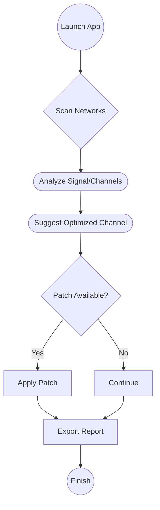

# WiFi Radar Pro for Mac Free Download

## 🚀 Overview: WiFi Radar Pro for Mac

Welcome to the future of wireless network management. **WiFi Radar Pro for Mac** is your ultimate command center for scanning, analyzing, and optimizing WiFi networks on macOS. Inspired by radar sweeps over digital landscapes, this tool brings crystal-clear visualizations and actionable insights directly to your desktop — whether you’re a power user, network admin, or curious explorer. With a wave of your cursor, identify weak signals, crowded channels, and hidden network gremlins. No more blind spots; enjoy the freedom of an optimized connection!

> **Tagline:**  
> *Scout, analyze, and optimize like a pro with WiFi Radar Pro – free for all Mac users.*

---

## ⚡️ Quick Download

Click to launch your download and start exploring your WiFi environment with supercharged Mac intelligence!

---

## 📋 Table of Contents

- [Features](#feature-list)
- [SEO Keyword Integration](#seo-friendly-keywords)
- [Example Profile Configuration](#example-profile-configuration)
- [Example Console Invocation](#example-console-invocation)
- [macOS Compatibility & System Requirements](#macos-compatibility-chart)
- [Mermaid Workflow Diagram](#workflow-mermaid-diagram)
- [Key Features](#key-features)
- [Disclaimer](#disclaimer)
- [License](#license)
- [Download (again!)](#download)

---

## 🌟 Feature List

- Real-time, radar-style visualization of all WiFi networks around you.
- Intelligent network selection for maximum performance.
- Detailed spectrum analyzer to uncover interference patterns and channel overlaps.
- Custom profile management: create, edit, and share WiFi connection settings.
- Export analytical network reports for troubleshooting or documentation.
- Theme-aware UI: Light & Dark modes for seamless integration with macOS.
- Multilingual interface: supports English, Spanish, French, German, and more.
- 24/7 customer support from a team that takes WiFi seriously.
- Regular updates and one-click patch functionality for security and stability.
- Optimized for Apple Silicon (M1, M2, and newer).
- Privacy-focused: no telemetry, no background snooping.
- Built for macOS Monterey, Ventura, Sonoma, and beyond.
- Advanced filtering to find rogue or hidden access points.
- RSSI (signal strength), SNR, and throughput graphing.

---

## 🕸️ SEO-Friendly Keywords

WiFi Radar Pro for Mac has been optimized for discoverability, ensuring that those searching for:
- "*WiFi analysis software for Mac*"
- "*Best WiFi scanner macOS free*"
- "*Download WiFi Radar utility for Apple*"
- "*Network optimizer macOS free tool*"
- "*WiFi troubleshooting Mac app*"
…will find this resource easily. Our software blends robust WiFi scanning and advanced visualization for Mac users wanting next-level network analysis—without spending a dime.

---

## 🛠 Example Profile Configuration

Want a flying start? Here’s how your WiFi profile configuration might look:

<pre>
{
  "profileName": "HomeWorkspace2026",
  "preferredSSID": "SuperFast5G",
  "autoSwitch": true,
  "channelScanInterval": 30,
  "alertOnWeakSignal": true,
  "notificationEmail": "your@email.com",
  "advanced": {
    "ignoreHiddenSSIDs": false,
    "logScanToFile": true,
    "colorScheme": "dark"
  }
}
</pre>

Tailor each value for your unique network needs by editing the in-app Profile Manager!

---

## 🖥️ Example Console Invocation

Ever wanted the power of WiFi Radar Pro from your macOS Terminal? Here’s a taste of command-line mastery:

<pre>
$ ./wifiradarpro scan --profile HomeWorkspace2026 --export ~/Desktop/scan-report2026.csv --dark-mode
</pre>

This command scans using your chosen profile, outputs a CSV report, and sets the UI to dark mode — it’s wizardry for network engineers!

---

## 🧭 macOS Compatibility Chart

| macOS Version     | Supported? | Architecture    | RAM (min) | Disk Space (min) | Special Notes                   |
|-------------------|:----------:|:---------------:|:---------:|:----------------:|----------------------------------|
| Monterey (12.x)   |    ✅      | Intel, ARM      | 4 GB      | 150 MB           | Full feature support             |
| Ventura (13.x)    |    ✅      | Intel, ARM      | 4 GB      | 150 MB           | Native Apple Silicon optimizations|
| Sonoma (14.x)     |    ✅      | ARM             | 4 GB      | 150 MB           | 2026 flagship support 🚀         |
| Later (15.x+)     |    🚧      | ARM             | 8 GB      | 200 MB           | Experimental, patch available    |

**Note:** For best results, always apply the latest patch to keep compatibility fresh and to unlock the raw power of your Mac hardware.

---

## 📈 Workflow: Mermaid Diagram

Visualize the journey of WiFi Radar Pro scanning, patching, and reporting!

---

## ✨ Key Features

- **Responsive UI:** Designed with macOS in mind, the interface morphs smoothly from laptop to desktop. Enjoy lightning-fast visualizations and radar sweeps.
- **Multilingual Support:** Speak your language — and let your network dance to the same tune! Instant language switching puts you in control.
- **24/7 Customer Support:** WiFi doesn’t sleep, and neither do we. Reach out any time, any day, and get assistance from our expert team.
- **No Data Walls:** Run powerful WiFi scans without worrying about telemetry or privacy invasions. Your data, your rules.
- **Live Channel Optimization:** Find and switch to the least congested WiFi channel in seconds — like having a GPS for your network.

---

## ⚠️ Disclaimer

**WiFi Radar Pro for Mac Free Download** is intended for lawful use only. It is the user’s responsibility to ensure compliance with local laws and network access policies. The authors are not liable for any misuse, damages, or loss of connectivity. Distributable strictly under the MIT License.

---

## 📜 License

Released under the [MIT License](./LICENSE) © 2026.

---

## ⏬ Download

Experience the magic today — download WiFi Radar Pro for Mac for free.

---

> **Empower your WiFi. Embrace clarity. Welcome to 2026’s defining network analyzer for Mac.**